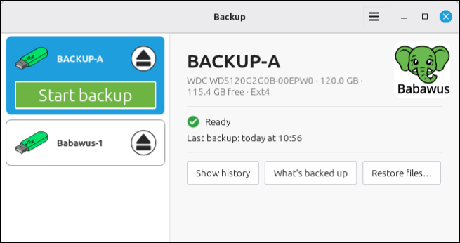

# Babawus

**BA**sic **BA**ckup **W**ith **U**sb **S**torage

Babawus is an application designed to make it easy to maintain backups of important files on detachable USB media (USB sticks). Think of it as the backup solution you might set up for your Gramps. Once it has been set up, all Gramps has to do is (and the order of the first two steps does not matter, should Gramps get confused):

1. Insert their USB stick
2. Start Babawus (just put a link to Babawus on their desktop)
3. Click a button
4. Remove the stick when Babawus says the backup is done.

That's it. The green elephant logo? Because it's cute and elephants never forget.

For the thinking behind Babawus, who it is for and why it works the way it does, see [Concept.md](projectmgt/Concept.md).

## General concept

All configuration and data are stored on the stick. The aim is ease of use, not complete data security so saved files are not encrypted (yet - may come in a later release). So keep the backup USB media safe somewhere (good advice in any case). But Babawus does protect against:

- **Hardware loss**: a dead disk, or a computer that is stolen, broken or destroyed.
- **Accidental deletion** of files.
- **Accidentally overwritten files**: a document saved over or emptied by mistake. The previous version is kept on the medium.
- **Corrupted files**: a damaged file is backed up as a new version, and the previous, good version is kept.

Ransomware is partly covered: encrypted files are backed up as new versions, but the older, good versions survive, as long as the medium was not plugged in during the attack.

Babawus never deletes your files from the USB stick. The only thing it ever removes is the oldest versions beyond the number you have chosen to keep (10 by default, 1 to 99).

Each stick keeps a log of every backup made to it, so you can see what happened if something went wrong. It is kept below 1 MB, enough for several thousand entries, by removing the oldest runs; the last run of each account is always kept. Babawus has a built-in log viewer, and the log is plain text, so it can also be read in any text editor. [UserGuide.md](UserGuide.md) explains where to find it.

The simple day-to-day backup operations are by design very easy to carry out. The more tricky setup stuff that involves things like formatting USB sticks and tuning settings is kept under Advanced in the menu, behind a "You are entering a dangerous area, are you sure you want to do that?" warning.

## Getting your files back

Choose "Restore files…" for the stick, tick the files and folders you want back, and pick an older version of a file if you need one. You don't even need Babawus for it: the files on the stick are ordinary files in ordinary folders, so you can copy them back with any file manager, on any computer that can read the stick.

## A reminder at login

Babawus can remind a user at login when their last backup is too long ago, and offer to start one. Set your desktop up to run Babawus at login, and Babawus checks whether the last backup is more days ago than configured (7 by default). If not, Babawus quietly closes, but if too many days have passed since the last backup, Babawus asks the user whether a backup should be run. [UserGuide.md](UserGuide.md) explains how to set it up.

## Adding a language

Babawus comes in English, German and Danish. Other languages can be added as language files, without a new build: [AddingALanguage.md](AddingALanguage.md) explains how.

## Built-in help

There is a built-in help system that provides general info and specifics on all error messages.

## Choice of file system

Babawus allows you to create USB backup media in two different file systems:

- **exFAT** Read- and writeable on almost any platform. Good for cross-platform usage.
- **Ext4** For Linux use only. Stands up better to a medium pulled out during a run (or other mishaps), and stores any name Linux allows.

## Supported platforms

This first version of Babawus only runs on Linux (it specifically targets Linux Mint 22.x with the Cinnamon desktop). More will follow, watch this space.

## Installing and uninstalling

Install Babawus by double-clicking the `.deb` package and choosing "Install Package". Install a newer version the same way: it replaces the old one, and keeps the chosen language and everything on the sticks.

To uninstall Babawus, run `sudo apt remove babawus`, or remove it in the Software Manager. Your backups on the sticks are not touched. A few small files stay behind on the computer; [UserGuide.md](UserGuide.md) lists them and how to remove them.

## For developers

[DevEnvSetup.md](DevEnvSetup.md) explains how to build, test and package Babawus, and how to set up the development environment.

## Licence

Babawus is under the MIT licence; see [LICENSE](LICENSE).
